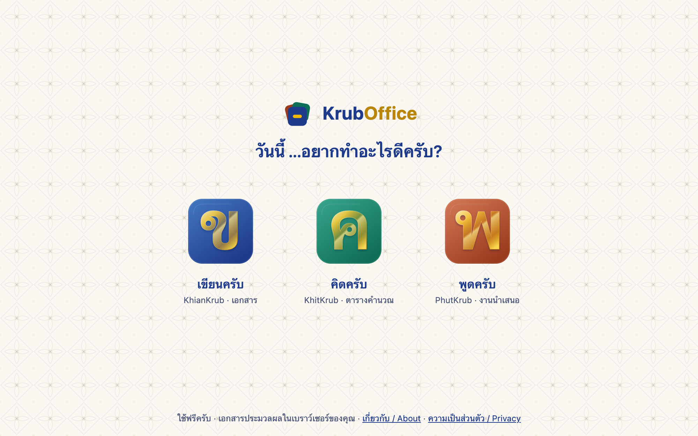
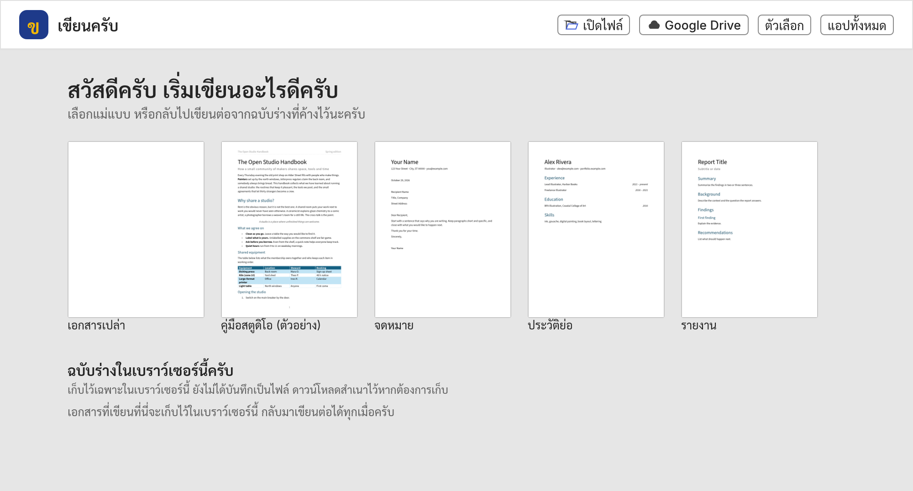
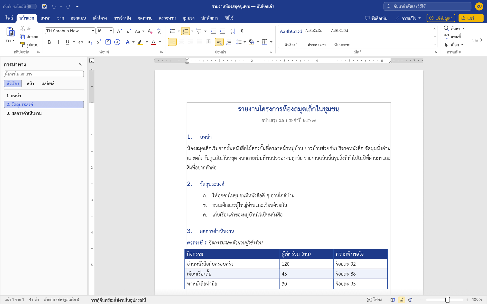
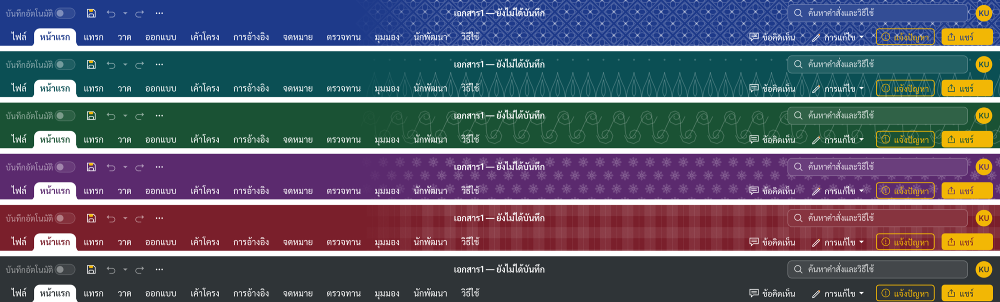
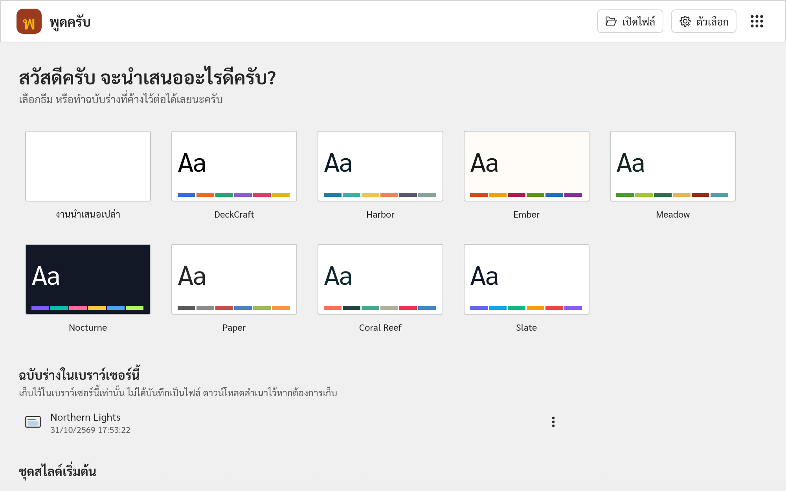
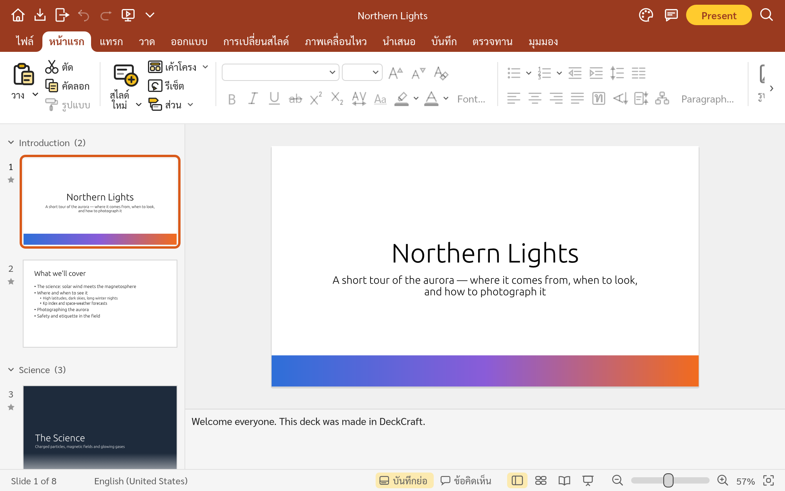
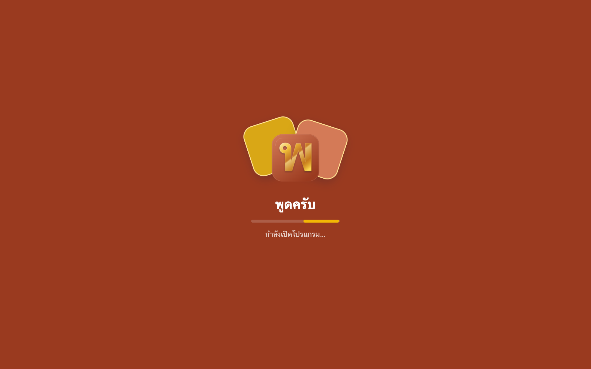
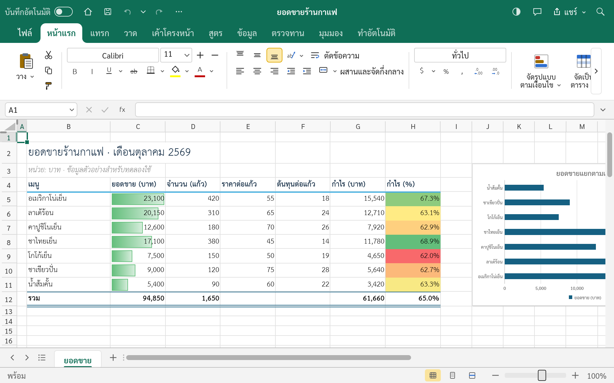
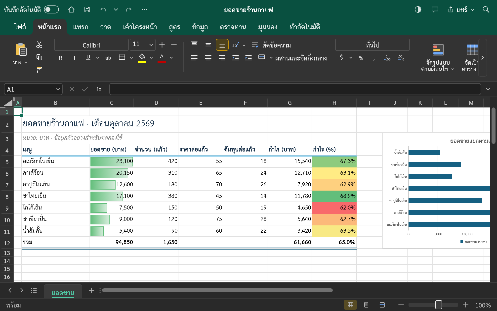
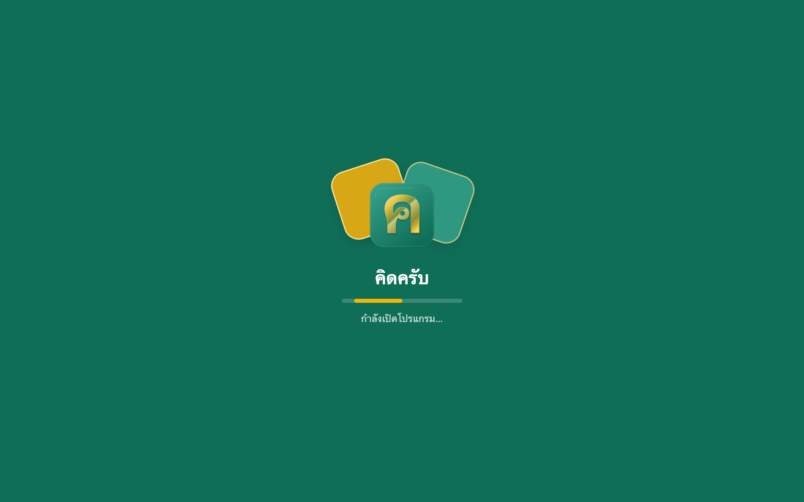

  

# KrubOffice

**ชุดโปรแกรมสำนักงานภาษาไทย ใช้ฟรีในเบราว์เซอร์ ไม่ต้องติดตั้ง ไม่ต้องสมัครสมาชิก**

**Free Thai office apps in the browser. Nothing to install, no account to make.**

**[เปิด / Open kruboffice.app](https://kruboffice.app/)** · [เขียนครับ · KhianKrub](https://khiankrub.app/) · [พูดครับ · PhutKrub](https://phutkrub.app/) · [คิดครับ · KhitKrub](https://khitkrub.app/)

  

## โปรแกรมในชุด / The apps

| โปรแกรม / App | ทำอะไร / What it does | พัฒนาต่อยอดจาก / Based on | สถานะ / Status |
|---|---|---|---|
| **เขียนครับ · KhianKrub** | พิมพ์เอกสาร เปิดและบันทึกไฟล์ Word (`.docx`) / Word processor, opens and saves `.docx` | [WordCraft](https://github.com/storytold/wordcraft) | ใช้ได้แล้ว / Available: **[khiankrub.app](https://khiankrub.app/)** |
| **พูดครับ · PhutKrub** | ทำงานนำเสนอ เปิดและบันทึกไฟล์ PowerPoint (`.pptx`) / Presentations, opens and saves `.pptx` | [DeckCraft](https://github.com/storytold/deckcraft) | ใช้ได้แล้ว / Available: **[phutkrub.app](https://phutkrub.app/)** |
| **คิดครับ · KhitKrub** | ตารางคำนวณ เปิดและบันทึกไฟล์ Excel (`.xlsx`) / Spreadsheets, opens and saves `.xlsx` | [GridCraft](https://github.com/storytold/gridcraft) | ใช้ได้แล้ว / Available: **[khitkrub.app](https://khitkrub.app/)** |

ใช้ได้ฟรีบนคอมพิวเตอร์และ iPad ยังไม่รองรับโทรศัพท์มือถือ / Free on computers and iPads; phones aren't supported yet.

## ที่มาของโปรแกรม / Where the apps come from

**ภาษาไทย** KrubOffice ไม่ได้เริ่มจากศูนย์ครับ ทุกโปรแกรมพัฒนาต่อยอดจากโปรแกรมโอเพนซอร์สของโครงการ **[ArtCraft](https://github.com/storytold)** ซึ่งเป็นชุด "Crafting Apps" ที่ทีม ArtCraft เขียนขึ้นใหม่ทั้งหมดด้วยภาษา Rust (แบบ clean-room คือเขียนจากการใช้งาน ไม่คัดลอกโค้ดหรือหน้าตาของโปรแกรมเชิงพาณิชย์) และเผยแพร่ภายใต้สัญญาอนุญาต MIT หรือ Apache-2.0 เราเก็บสัญญาอนุญาตและเครดิตของเขาไว้ครบ แล้วปรับให้เหมาะกับผู้ใช้ภาษาไทย:

- **เมนูและข้อความเป็นภาษาไทย** เปิดครั้งแรกเป็นภาษาไทย สลับเป็นภาษาอังกฤษได้ในคลิกเดียว
- **ฟอนต์ไทย** เมนูใช้ Sarabun งานใหม่ในเขียนครับและพูดครับใช้ TH Sarabun New เป็นค่าเริ่มต้น ส่วนคิดครับใช้ TH Sarabun New วาดตัวอักษรไทยในเซลล์
- **หน้าตาแบบ KrubOffice** แถบด้านบนสีประจำแอป (กรมท่าของเขียนครับ ส้มอิฐของพูดครับ เขียวอมน้ำเงินของคิดครับ) ไฮไลต์สีทอง
- **หน้าเริ่มต้นและฉบับร่างในเบราว์เซอร์** เลือกแม่แบบ หรือเขียนต่อจากฉบับร่างที่ค้างไว้
- เขียนครับยังมี **การตัดคำไทย** **การจัดข้อความแบบกระจายไทย** รายการเลขไทย และฟอนต์ SIPA / TLWG

**English** KrubOffice did not start from scratch. Each app is a Thai adaptation of an open-source app from **[ArtCraft](https://github.com/storytold)**'s "Crafting Apps", which the ArtCraft team wrote from scratch in Rust (clean-room: built from how such programs are used, not from any commercial program's code or look) and released under MIT or Apache-2.0. We keep their licences and credits and adapt the apps for Thai users:

- **Thai menus and text**: the apps open in Thai on a first visit and switch to English in one click.
- **Thai fonts**: Sarabun for menus; new work in KhianKrub and PhutKrub defaults to TH Sarabun New, while KhitKrub uses TH Sarabun New to draw Thai letters in cells.
- **A KrubOffice look**: a top band in each app's own colour (navy for KhianKrub, coral for PhutKrub, teal for KhitKrub) with gold highlights.
- **A start screen with browser drafts**: pick a template, or carry on with a draft kept in the browser.
- KhianKrub also has **Thai word breaking**, **Thai Distribution** justification, Thai list numbering and the SIPA / TLWG fonts.

เขียนครับ พูดครับ และคิดครับไม่ใช่ผลิตภัณฑ์ของ ArtCraft และไม่เกี่ยวข้องกับ Microsoft / KhianKrub, PhutKrub and KhitKrub are not ArtCraft products and are not affiliated with Microsoft. The Thai adaptations are by **Chanon Sarasuk**.

## สิ่งที่ใช้ร่วมกัน / What the apps share

| ภาษาไทย | English |
|---|---|
| หน้ารวม kruboffice.app และปุ่มสลับแอป (จุดเก้าจุด) ที่หน้าเริ่มต้นของทุกโปรแกรม | One front page, kruboffice.app, and an app switcher (the nine-dot button) on every start screen |
| หน้าเริ่มต้นเหมือนกัน: แม่แบบ ฉบับร่างในเบราว์เซอร์ เปิดไฟล์ ตัวเลือก | The same start screen: templates, drafts kept in the browser, Open file, Options |
| งานเปิดในแท็บใหม่ หน้าเริ่มต้นยังอยู่ที่เดิม | Each document opens in a new tab; the start screen stays where it is |
| ฉบับร่างเก็บในเบราว์เซอร์ของคุณเท่านั้น ไฟล์ไม่ถูกส่งไปที่ใด | Drafts are kept in your own browser only; your files are not uploaded anywhere |
| ไอคอนชุดเดียวกันและริบบิ้นขนาดเดียวกันทุกโปรแกรม | One icon set and one ribbon layout in every app |
| ธีมสว่างและธีมมืด | Light and dark themes |
| ตั้งค่าภาษาครั้งเดียว โปรแกรมจำไว้ให้ | Choose the language once; the app remembers it |

## หน้าตาและความสามารถ / A look and the key features

### เขียนครับ · KhianKrub

<table>
<tr>
<td width="50%" valign="top">
<b>หน้าเริ่มต้น / Start screen</b>
</td>
<td width="50%" valign="top">
<b>เอกสารภาษาไทย / A Thai document</b>
</td>
</tr>
</table>

- เปิด แก้ไข และบันทึกไฟล์ Word (`.docx`) ส่งออก PDF / Open, edit and save `.docx`, and export PDF
- ตัดคำไทย จัดข้อความแบบกระจายไทย เลขและตัวอักษรไทยในรายการ / Thai word breaking, Thai Distribution, Thai list numbering
- เลือกสีแถบด้านบนได้หกสี พร้อมลวดลายไทยจาง ๆ / Six band colours with optional faint Thai motifs
- บันทึกลงเครื่อง หรือ Google Drive / Save to this device or Google Drive

  

### พูดครับ · PhutKrub

<table>
<tr>
<td width="50%" valign="top">
<b>หน้าเริ่มต้น / Start screen</b>
</td>
<td width="50%" valign="top">
<b>แก้ไขสไลด์ / Editing slides</b>
</td>
</tr>
</table>

- สร้างสไลด์จากธีมและชุดสไลด์เริ่มต้น ใส่รูปร่าง รูปภาพ ตาราง แผนภูมิ / Start from themes and starter decks; add shapes, pictures, tables and charts
- เอฟเฟกต์การเปลี่ยนสไลด์และภาพเคลื่อนไหว นำเสนอเต็มจอ / Transitions, animations and a full-screen slide show
- เปิดและบันทึกไฟล์ PowerPoint (`.pptx`) / Open and save `.pptx`
- จัดข้อความแบบกระจายไทย (ปุ่มตัว ท) / Thai Distribution (the ท button)
- สไลด์ใหม่ใช้ TH Sarabun New / New slides use TH Sarabun New

<table>
<tr>
<td width="60%" valign="top">
<b>ธีมมืด / Dark theme.</b> เมนูและแถบเครื่องมือเป็นสีเข้ม สไลด์ยังขาวเหมือนตอนนำเสนอ / Menus and panes go dark; the slide stays as it will be shown.
</td>
<td width="40%" valign="top">
<b>หน้ารอเปิดโปรแกรม / Loading screen.</b> ครั้งแรกอาจใช้เวลาสักครู่ / The first visit can take a moment.
</td>
</tr>
</table>

### คิดครับ · KhitKrub

<table>
<tr>
<td width="50%" valign="top">
<b>หน้าเริ่มต้น / Start screen</b>
</td>
<td width="50%" valign="top">
<b>ตารางคำนวณ / A spreadsheet</b>
</td>
</tr>
</table>

- สูตรและฟังก์ชันกว่า 500 ตัว แผนภูมิ ตารางสรุปข้อมูล การจัดรูปแบบตามเงื่อนไข / 500+ functions, charts, pivot tables and conditional formatting
- เปิดและบันทึกไฟล์ Excel (`.xlsx`) และ CSV / Open and save `.xlsx` and CSV
- ตัวอักษรไทยในเซลล์ใช้ TH Sarabun New ตัวเลขและอังกฤษใช้ฟอนต์เริ่มต้น / Thai letters in cells use TH Sarabun New; Latin text and numbers keep the default font
- รุ่นแรก: ชื่อฟังก์ชันในสูตรยังเป็นภาษาอังกฤษ ยังไม่มีเลขไทย วันที่ พ.ศ. หรือการอ่านจำนวนเงินเป็นตัวอักษร / First release: function names stay English; no Thai digits, Buddhist-era dates or baht-in-words yet

<table>
<tr>
<td width="60%" valign="top">
<b>ธีมมืด / Dark theme.</b> ตารางยังขาวเหมือนตอนพิมพ์ / The sheet stays white, as it will print.
</td>
<td width="40%" valign="top">
<b>หน้ารอเปิดโปรแกรม / Loading screen.</b> ครั้งแรกอาจใช้เวลาสักครู่ / The first visit can take a moment.
</td>
</tr>
</table>

## มีอะไรใหม่ / What's new

**2 พฤศจิกายน 2569 / 2 November 2026**

- **หน้า KrubOffice ใช้ไอคอนแบบกระจกชุดใหม่** ตัว ข ค พ สีทองแบบเดียวกับโลโก้ของแต่ละโปรแกรม / **The KrubOffice page has the new glass icons**: the same gold ข, ค and พ as each app's logo.
- **กรอบสีของแต่ละโปรแกรม** เมื่อชี้หรือเลือกไอคอน กรอบรอบไอคอนเป็นสีของโปรแกรมนั้น สีกรมท่าสำหรับเขียนครับ สีเขียวอมน้ำเงินสำหรับคิดครับ และสีส้มอิฐสำหรับพูดครับ / **Each app's own ring.** Pointing at or selecting an icon draws a ring in that app's colour: navy for KhianKrub, teal for KhitKrub and coral for PhutKrub.
- **ภาพเคลื่อนไหวขณะรอเปิดโปรแกรม** พูดครับและคิดครับมีแผ่นสีทองกับแผ่นสีของโปรแกรมลอยเข้ามาซ้อนหลังโลโก้ แบบเดียวกับเขียนครับ / **A loading animation** in PhutKrub and KhitKrub: a gold sheet and a sheet in the app's colour fly in behind the logo, as in KhianKrub.

**1 พฤศจิกายน 2569 (ไอคอนชุดใหม่) / 1 November 2026 (new icons)**

- **ไอคอนชุดใหม่ใช้ร่วมกันทั้งสามโปรแกรม** ไอคอนบนริบบิ้นวาดใหม่ทั้งชุด เส้นสีเข้มอ่านง่าย แต้มสีทองเฉพาะส่วนสำคัญ ปุ่มเดียวกันจึงหน้าตาเหมือนกันทั้งเขียนครับ พูดครับ และคิดครับ / **One new icon set for all three apps.** Every ribbon icon is redrawn with dark, easy-to-read lines and a touch of gold where it matters, so the same button looks the same in KhianKrub, PhutKrub and KhitKrub.
- **ริบบิ้นแบบเดียวกัน** พูดครับและคิดครับใช้ขนาดริบบิ้นของเขียนครับ ไอคอนใหญ่ขึ้น ปุ่มเรียงกึ่งกลาง / **One ribbon layout.** PhutKrub and KhitKrub now use KhianKrub's ribbon: larger icons, centred buttons.
- **พูดครับจัดข้อความแบบกระจายไทยได้** ปุ่มตัว ท ถัดจากปุ่มจัดชิดขอบทั้งสองด้าน กระจายระยะระหว่างตัวอักษรไทยให้เต็มบรรทัด บันทึกลงไฟล์ `.pptx` ได้ เขียนครับมีความสามารถนี้อยู่แล้วและได้ไอคอน ท เหมือนกัน / **Thai Distribution in PhutKrub.** A ท button next to Justify spreads the space between Thai letters to fill each line, and is saved in `.pptx`. KhianKrub already had it and gets the same ท icon.
- **โลโก้แบบกระจก** ตัว ข ค พ สีทองมีประกายแบบกระจก ที่หน้ารอเปิดโปรแกรมและหน้าเริ่มต้นของแต่ละโปรแกรม / **Glass logos.** A gold ข, ค and พ with a glass shine on each app's loading and start screens.

  
  
  

<table>
<tr>
<td width="33%" valign="top">
<b>เขียนครับ</b>
</td>
<td width="33%" valign="top">
<b>พูดครับ</b>
</td>
<td width="33%" valign="top">
<b>คิดครับ</b>
</td>
</tr>
</table>

**1 พฤศจิกายน 2569 / 1 November 2026**

- **คิดครับ (KhitKrub) เปิดให้ใช้แล้ว** ที่ [khitkrub.app](https://khitkrub.app/) เมนูไทย ฟอนต์ไทย แถบด้านบนสีเขียวอมน้ำเงิน ไฮไลต์สีทอง หน้าเริ่มต้นพร้อมฉบับร่างในเบราว์เซอร์ / **KhitKrub is available** at [khitkrub.app](https://khitkrub.app/): Thai menus and fonts, a teal top band with gold highlights, and a start screen with browser drafts.
- **หน้า KrubOffice** มีไอคอนคิดครับพร้อมใช้ และปุ่มสลับแอปในทุกโปรแกรมพาไปยังคิดครับได้ / **The KrubOffice page** now has KhitKrub's icon ready to open, and every app's switcher leads to it.

**31 ตุลาคม 2569 / 31 October 2026**

- **พูดครับ (PhutKrub) เปิดให้ใช้แล้ว** ที่ [phutkrub.app](https://phutkrub.app/) เมนูไทย ฟอนต์ไทย แถบด้านบนสีส้มอิฐ ไฮไลต์สีทอง หน้าเริ่มต้นพร้อมฉบับร่างในเบราว์เซอร์ / **PhutKrub is available** at [phutkrub.app](https://phutkrub.app/): Thai menus and fonts, a coral top band with gold highlights, and a start screen with browser drafts.
- **หน้า KrubOffice** มีไอคอนพูดครับพร้อมใช้ และปุ่มสลับแอปในพูดครับพาไปยังเขียนครับได้ / **The KrubOffice page** now has PhutKrub's icon ready to open, and PhutKrub's app switcher leads to KhianKrub.

ประวัติรุ่นของแต่ละโปรแกรมอยู่ที่หน้า Releases ของ [khiankrub-web](https://github.com/chanonss/khiankrub-web/releases), [phutkrub-web](https://github.com/chanonss/phutkrub-web/releases) และ [khitkrub-web](https://github.com/chanonss/khitkrub-web/releases) / Each app's release history is on its Releases page.

## เริ่มใช้งาน / Getting started

1. เปิด / Visit **[kruboffice.app](https://kruboffice.app/)** บนคอมพิวเตอร์หรือ iPad / on a computer or iPad.
2. เลือกโปรแกรม แล้วเลือกแม่แบบหรือฉบับร่างที่หน้าเริ่มต้น หรือกด **เปิดไฟล์** / Pick an app, then a template or a draft on its start screen, or press **Open file**.
3. บันทึกงานผ่าน **ไฟล์ → บันทึก** แล้วเก็บไฟล์ไว้ในเครื่อง / Save through **File → Save** and keep the file on your device.

## ความเป็นส่วนตัว / Privacy

งานของคุณถูกประมวลผลในเบราว์เซอร์ ไม่ถูกส่งขึ้นเซิร์ฟเวอร์ ฉบับร่างเก็บไว้ในเบราว์เซอร์ของอุปกรณ์เครื่องนั้นเท่านั้น หากใช้เครื่องร่วมกับผู้อื่น ควรทิ้งฉบับร่างเมื่อเสร็จงาน การเชื่อมต่อ Google Drive ของเขียนครับเป็นทางเลือกและทำเมื่อคุณสั่งเท่านั้น รายละเอียดอยู่ที่ [นโยบายความเป็นส่วนตัว](https://khiankrub.app/privacy.html) / Your work is processed in the browser and not sent to a server. Drafts stay in that device's browser; on a shared device, discard them when you finish. KhianKrub's Google Drive connection is optional and only used when you ask for it. See the [privacy policy](https://khiankrub.app/privacy.html).

พบปัญหาหรือมีข้อเสนอแนะ กดปุ่ม **แจ้งปัญหา** ในเขียนครับ / Found a problem or have a suggestion? Press **Report a problem** (แจ้งปัญหา) in KhianKrub.

## เครดิตและสัญญาอนุญาต / Credits and licences

- เขียนครับและพูดครับพัฒนาต่อยอดจาก [WordCraft](https://github.com/storytold/wordcraft) และ [DeckCraft](https://github.com/storytold/deckcraft) โดยทีม ArtCraft (MIT หรือ Apache-2.0) ปรับปรุงสำหรับผู้ใช้ภาษาไทยโดย Chanon Sarasuk / KhianKrub and PhutKrub are based on WordCraft and DeckCraft by the ArtCraft team (MIT or Apache-2.0), adapted for Thai users by Chanon Sarasuk.
- ฟอนต์ Sarabun อยู่ภายใต้ SIL Open Font License 1.1 และ TH Sarabun New อยู่ภายใต้ GPL พร้อมข้อยกเว้นสำหรับฟอนต์ / Sarabun is under the SIL Open Font License 1.1; TH Sarabun New is under the GPL with the font exception. Other components keep their own licences: see [`ATTRIBUTION.md`](ATTRIBUTION.md) and [`NOTICE`](NOTICE).
- ภาพหน้าจอถ่ายจากโปรแกรมจริง ข้อความและงานตัวอย่างเป็นงานต้นฉบับ ไม่มีหน้าตาหรือสื่อของ Microsoft / The screenshots are taken from the running apps; the text and sample documents are original, with no Microsoft interface or assets.
- **ซอร์สโค้ดของเขียนครับและพูดครับเป็นส่วนตัวในขณะนี้** คลังนี้มีเฉพาะหน้ารวมที่คอมไพล์แล้ว / **The source code of KhianKrub and PhutKrub is currently private.** This repository holds the compiled front page only.
