

  

# KrubOffice

**ชุดโปรแกรมสำนักงานภาษาไทย ใช้ฟรีในเบราว์เซอร์ ไม่ต้องติดตั้ง ไม่ต้องสมัครสมาชิก**

**Free Thai office apps in the browser. Nothing to install, no account to make.**

**[เปิด / Open kruboffice.app](https://kruboffice.app/)** · [เขียนครับ · KhianKrub](https://khiankrub.app/) · [พูดครับ · PhutKrub](https://phutkrub.app/) · [คิดครับ · KhitKrub](https://khitkrub.app/)

  

## โปรแกรมในชุด / The apps

| โปรแกรม / App | ทำอะไร / What it does | พัฒนาต่อยอดจาก / Based on | สถานะ / Status |
|---|---|---|---|
| **เขียนครับ · KhianKrub** | พิมพ์เอกสาร เปิดและบันทึกไฟล์ Word (`.docx`) / Word processor, opens and saves `.docx` | [WordCraft](https://github.com/storytold/wordcraft) | ใช้ได้แล้ว / Available: **[khiankrub.app](https://khiankrub.app/)** |
| **พูดครับ · PhutKrub** | ทำงานนำเสนอ เปิดและบันทึกไฟล์ PowerPoint (`.pptx`) / Presentations, opens and saves `.pptx` | [DeckCraft](https://github.com/storytold/deckcraft) | ใช้ได้แล้ว / Available: **[phutkrub.app](https://phutkrub.app/)** |
| **คิดครับ · KhitKrub** | ตารางคำนวณ เปิดและบันทึกไฟล์ Excel (`.xlsx`) / Spreadsheets, opens and saves `.xlsx` | [GridCraft](https://github.com/storytold/gridcraft) | ใช้ได้แล้ว / Available: **[khitkrub.app](https://khitkrub.app/)** |

ใช้ได้ฟรีบนคอมพิวเตอร์และ iPad ยังไม่รองรับโทรศัพท์มือถือ / Free on computers and iPads; phones aren't supported yet.

## ที่มาของโปรแกรม / Where the apps come from

**ภาษาไทย** KrubOffice ไม่ได้เริ่มจากศูนย์ครับ ทุกโปรแกรมพัฒนาต่อยอดจากโปรแกรมโอเพนซอร์สของโครงการ **[ArtCraft](https://github.com/storytold)** ซึ่งเป็นชุด "Crafting Apps" ที่ทีม ArtCraft เขียนขึ้นใหม่ทั้งหมดด้วยภาษา Rust (แบบ clean-room คือเขียนจากการใช้งาน ไม่คัดลอกโค้ดหรือหน้าตาของโปรแกรมเชิงพาณิชย์) และเผยแพร่ภายใต้สัญญาอนุญาต MIT หรือ Apache-2.0 เราเก็บสัญญาอนุญาตและเครดิตของเขาไว้ครบ แล้วปรับให้เหมาะกับผู้ใช้ภาษาไทย:

- **เมนูและข้อความเป็นภาษาไทย** เปิดครั้งแรกเป็นภาษาไทย สลับเป็นภาษาอังกฤษได้ในคลิกเดียว
- **ฟอนต์ไทย** เมนูใช้ Sarabun งานใหม่ในเขียนครับและพูดครับใช้ TH Sarabun New เป็นค่าเริ่มต้น ส่วนคิดครับใช้ TH Sarabun New วาดตัวอักษรไทยในเซลล์
- **หน้าตาแบบ KrubOffice** แถบด้านบนสีประจำแอป (กรมท่าของเขียนครับ ส้มอิฐของพูดครับ เขียวอมน้ำเงินของคิดครับ) ไฮไลต์สีทอง
- **หน้าเริ่มต้นและฉบับร่างในเบราว์เซอร์** เลือกแม่แบบ หรือเขียนต่อจากฉบับร่างที่ค้างไว้
- เขียนครับยังมี **การตัดคำไทย** **การจัดข้อความแบบกระจายไทย** รายการเลขไทย และฟอนต์ SIPA / TLWG

**English** KrubOffice did not start from scratch. Each app is a Thai adaptation of an open-source app from **[ArtCraft](https://github.com/storytold)**'s "Crafting Apps", which the ArtCraft team wrote from scratch in Rust (clean-room: built from how such programs are used, not from any commercial program's code or look) and released under MIT or Apache-2.0. We keep their licences and credits and adapt the apps for Thai users:

- **Thai menus and text**: the apps open in Thai on a first visit and switch to English in one click.
- **Thai fonts**: Sarabun for menus; new work in KhianKrub and PhutKrub defaults to TH Sarabun New, while KhitKrub uses TH Sarabun New to draw Thai letters in cells.
- **A KrubOffice look**: a top band in each app's own colour (navy for KhianKrub, coral for PhutKrub, teal for KhitKrub) with gold highlights.
- **A start screen with browser drafts**: pick a template, or carry on with a draft kept in the browser.
- KhianKrub also has **Thai word breaking**, **Thai Distribution** justification, Thai list numbering and the SIPA / TLWG fonts.

เขียนครับ พูดครับ และคิดครับไม่ใช่ผลิตภัณฑ์ของ ArtCraft และไม่เกี่ยวข้องกับ Microsoft / KhianKrub, PhutKrub and KhitKrub are not ArtCraft products and are not affiliated with Microsoft. The Thai adaptations are by **Chanon Sarasuk**.

## สิ่งที่ใช้ร่วมกัน / What the apps share

| ภาษาไทย | English |
|---|---|
| หน้ารวม kruboffice.app และปุ่มสลับแอป (จุดเก้าจุด) ที่หน้าเริ่มต้นของทุกโปรแกรม | One front page, kruboffice.app, and an app switcher (the nine-dot button) on every start screen |
| หน้าเริ่มต้นเหมือนกัน: แม่แบบ ฉบับร่างในเบราว์เซอร์ เปิดไฟล์ ตัวเลือก | The same start screen: templates, drafts kept in the browser, Open file, Options |
| งานเปิดในแท็บใหม่ หน้าเริ่มต้นยังอยู่ที่เดิม | Each document opens in a new tab; the start screen stays where it is |
| ฉบับร่างเก็บในเบราว์เซอร์ของคุณเท่านั้น ไฟล์ไม่ถูกส่งไปที่ใด | Drafts are kept in your own browser only; your files are not uploaded anywhere |
| ไอคอนชุดเดียวกันและริบบิ้นขนาดเดียวกันทุกโปรแกรม | One icon set and one ribbon layout in every app |
| ธีมสว่างและธีมมืด | Light and dark themes |
| Google Drive: เชื่อมต่อในคลิกเดียว เปิดไฟล์จาก Drive แล้วกดบันทึกกลับไปที่ไฟล์เดิม หรือบันทึกเป็นสำเนาใหม่ | Google Drive: connect in one click, open a file from Drive and Save puts it back, or save a new copy |
| ตั้งค่าภาษาครั้งเดียว โปรแกรมจำไว้ให้ | Choose the language once; the app remembers it |

## หน้าตาและความสามารถ / A look and the key features

### เขียนครับ · KhianKrub

<table>
<tr>
<td width="50%" valign="top">
<b>หน้าเริ่มต้น / Start screen</b>
</td>
<td width="50%" valign="top">
<b>เอกสารภาษาไทย / A Thai document</b>
</td>
</tr>
</table>

- เปิด แก้ไข และบันทึกไฟล์ Word (`.docx`) ส่งออก PDF / Open, edit and save `.docx`, and export PDF
- ตัดคำไทย จัดข้อความแบบกระจายไทย เลขและตัวอักษรไทยในรายการ / Thai word breaking, Thai Distribution, Thai list numbering
- เลือกสีแถบด้านบนได้หกสี พร้อมลวดลายไทยจาง ๆ / Six band colours with optional faint Thai motifs
- บันทึกลงเครื่อง หรือ Google Drive / Save to this device or Google Drive

  

### พูดครับ · PhutKrub

<table>
<tr>
<td width="50%" valign="top">
<b>หน้าเริ่มต้น / Start screen</b>
</td>
<td width="50%" valign="top">
<b>แก้ไขสไลด์ / Editing slides</b>
</td>
</tr>
</table>

- สร้างสไลด์จากธีมและชุดสไลด์เริ่มต้น ใส่รูปร่าง รูปภาพ ตาราง แผนภูมิ / Start from themes and starter decks; add shapes, pictures, tables and charts
- เอฟเฟกต์การเปลี่ยนสไลด์และภาพเคลื่อนไหว นำเสนอเต็มจอ / Transitions, animations and a full-screen slide show
- เปิดและบันทึกไฟล์ PowerPoint (`.pptx`) / Open and save `.pptx`
- จัดข้อความแบบกระจายไทย (ปุ่มตัว ท) / Thai Distribution (the ท button)
- สไลด์ใหม่ใช้ TH Sarabun New / New slides use TH Sarabun New
- เปิดและบันทึกไฟล์ `.pptx` ใน Google Drive / Open and save `.pptx` files in Google Drive

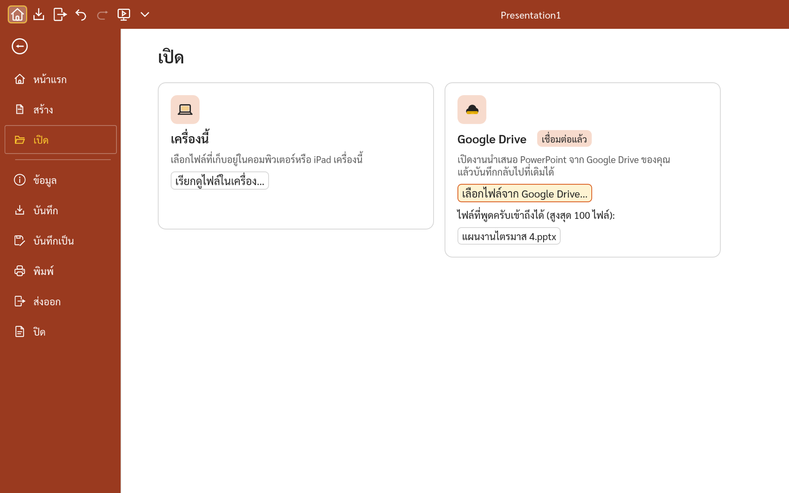 <b>เปิดจากเครื่องนี้หรือ Google Drive / Open from this device or Google Drive</b>

<table>
<tr>
<td width="60%" valign="top">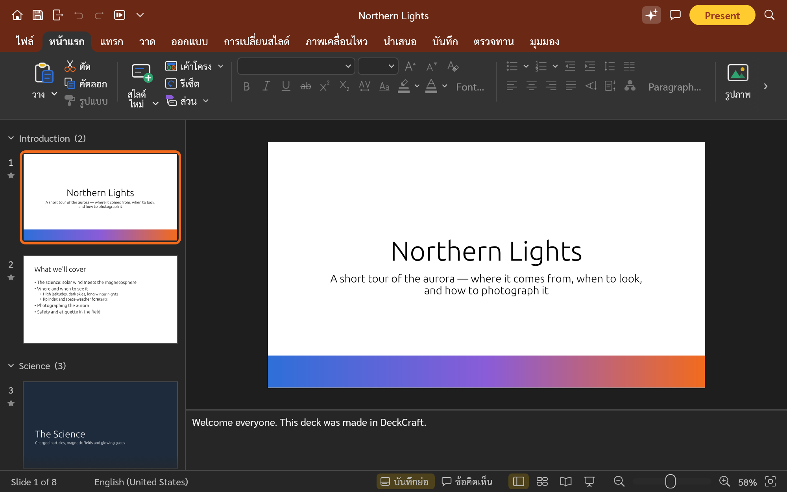
<b>ธีมมืด / Dark theme.</b> เมนูและแถบเครื่องมือเป็นสีเข้ม สไลด์ยังขาวเหมือนตอนนำเสนอ / Menus and panes go dark; the slide stays as it will be shown.
</td>
<td width="40%" valign="top">
<b>หน้ารอเปิดโปรแกรม / Loading screen.</b> ครั้งแรกอาจใช้เวลาสักครู่ / The first visit can take a moment.
</td>
</tr>
</table>

### คิดครับ · KhitKrub

<table>
<tr>
<td width="50%" valign="top">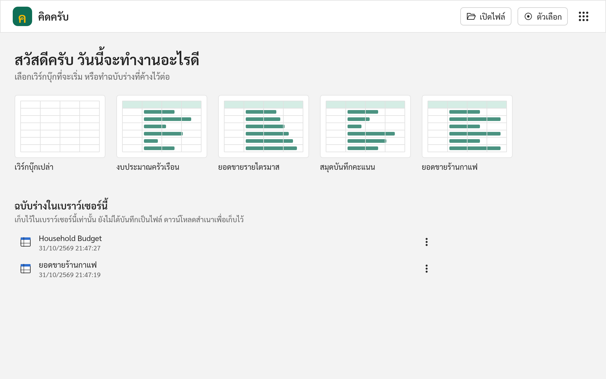
<b>หน้าเริ่มต้น / Start screen</b>
</td>
<td width="50%" valign="top">
<b>ตารางคำนวณ / A spreadsheet</b>
</td>
</tr>
</table>

- สูตรและฟังก์ชันกว่า 500 ตัว แผนภูมิ ตารางสรุปข้อมูล การจัดรูปแบบตามเงื่อนไข / 500+ functions, charts, pivot tables and conditional formatting
- เปิดและบันทึกไฟล์ Excel (`.xlsx`) และ CSV / Open and save `.xlsx` and CSV
- เปิดและบันทึกไฟล์ `.xlsx` ใน Google Drive / Open and save `.xlsx` files in Google Drive

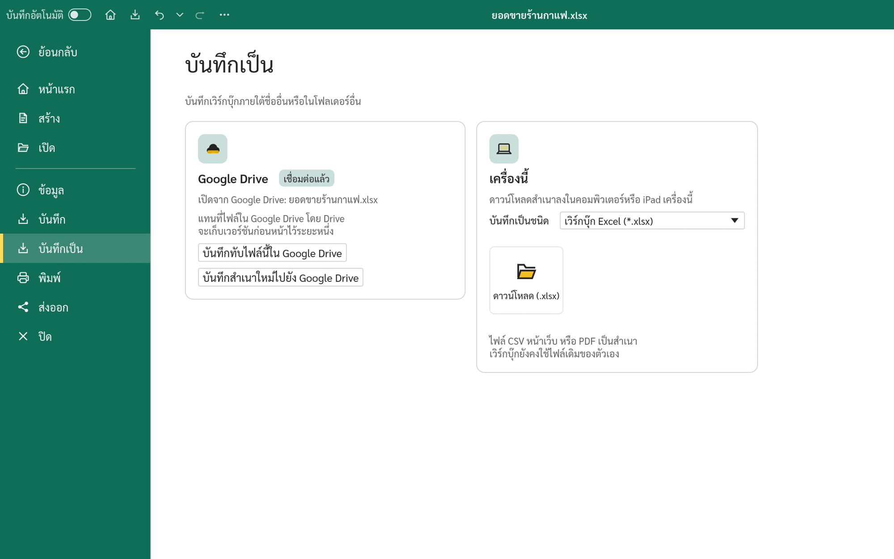 <b>บันทึกกลับไปที่ไฟล์เดิมใน Google Drive / Save back to the same file in Google Drive</b>

- ตัวอักษรไทยในเซลล์ใช้ TH Sarabun New ตัวเลขและอังกฤษใช้ฟอนต์เริ่มต้น / Thai letters in cells use TH Sarabun New; Latin text and numbers keep the default font
- รุ่นแรก: ชื่อฟังก์ชันในสูตรยังเป็นภาษาอังกฤษ ยังไม่มีเลขไทย วันที่ พ.ศ. หรือการอ่านจำนวนเงินเป็นตัวอักษร / First release: function names stay English; no Thai digits, Buddhist-era dates or baht-in-words yet

<table>
<tr>
<td width="60%" valign="top">
<b>ธีมมืด / Dark theme.</b> ตารางยังขาวเหมือนตอนพิมพ์ / The sheet stays white, as it will print.
</td>
<td width="40%" valign="top">
<b>หน้ารอเปิดโปรแกรม / Loading screen.</b> ครั้งแรกอาจใช้เวลาสักครู่ / The first visit can take a moment.
</td>
</tr>
</table>

## มีอะไรใหม่ / What's new

**5 พฤศจิกายน 2569 / 5 November 2026**

- **ฉบับร่างในอุปกรณ์นี้ ทั้งสามโปรแกรม** เอกสาร งานนำเสนอ หรือเวิร์กบุ๊กใหม่ที่ยังไม่ได้บันทึกเป็นไฟล์หรือลง Google Drive เรียกว่าฉบับร่างอย่างชัดเจน หน้าเริ่มต้นแสดง **ชื่อ (ฉบับร่าง)** แถบชื่อด้านบนแสดง **(ฉบับร่าง) — บันทึกในอุปกรณ์นี้แล้ว** และเมื่อทุกอย่างถูกเก็บแล้ว ปิดแท็บได้โดยเบราว์เซอร์ไม่ถาม ส่วนไฟล์ที่เปิดจากเครื่องหรือ Google Drive พูดครับและคิดครับจะถามก่อนปิดแท็บหากยังมีการแก้ไขที่ยังไม่ได้บันทึก แบบเดียวกับเขียนครับ / **Drafts on this device, in all three apps.** A new document, presentation or workbook not yet saved as a file or to Google Drive is plainly called a draft: the start screen lists **Name (draft)**, the title bar reads **(draft) — Saved on this device**, and once everything is kept the tab closes without the browser's "Leave site?" question. For a file opened from this device or Google Drive, PhutKrub and KhitKrub now ask before the tab closes with unsaved edits, as KhianKrub does.

  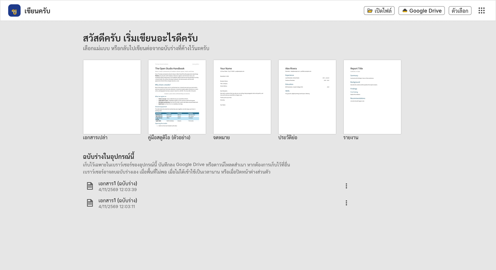

- **พูดครับ: มุมมองผู้บรรยายในหน้าต่างแยก** เมื่อเริ่มนำเสนอ สไลด์จะแสดงในแท็บเดิม และมุมมองผู้บรรยายเปิดในหน้าต่างใหม่ พร้อมสไลด์ปัจจุบัน สไลด์ถัดไป บันทึกย่อ และตัวจับเวลา ควบคุมการนำเสนอได้จากหน้าต่างใดก็ได้ / **PhutKrub: Presenter View in its own window.** When a show starts the slides stay in the tab and Presenter View opens in a new window with the current and next slide, notes and a timer; either window controls the show.

  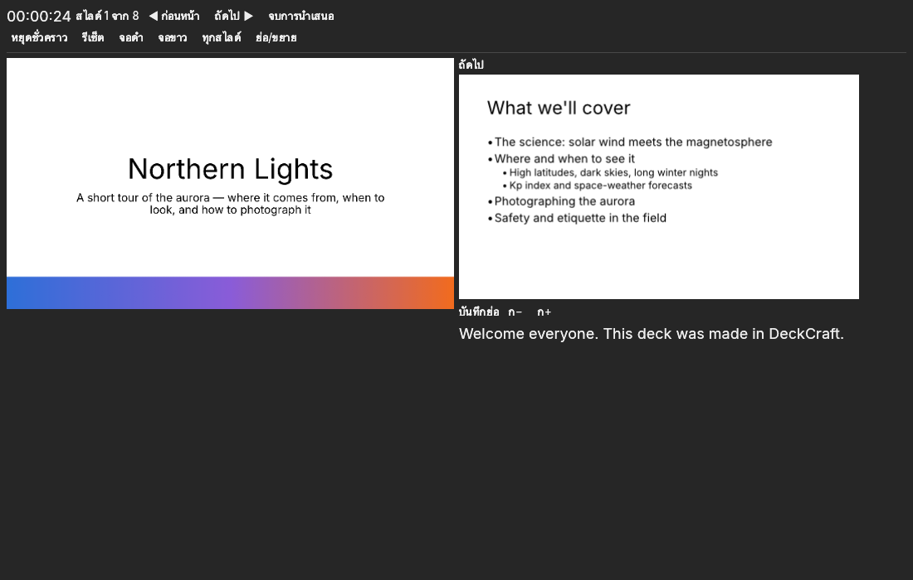

- **คิดครับ: อัปเดตจาก GridCraft** คลังฟังก์ชันในแท็บสูตรพร้อมไอคอนสมุดสีต่าง ๆ เปิดไฟล์ CSV ที่วันที่ขึ้นต้นด้วยวันได้ถูกต้อง ตรึงช่องแล้วเลื่อนดูได้ไม่หาย ค้นหาและแทนที่เฉพาะช่วงที่เลือก และสูตรจาก Google Sheets เปิดได้ตามเดิม / **KhitKrub: GridCraft update.** The Formulas tab's Function Library with coloured book icons, day-first dates in CSV files read correctly, frozen panes that keep their text while scrolling, Find and Replace within a selection, and formulas from Google Sheets kept.

  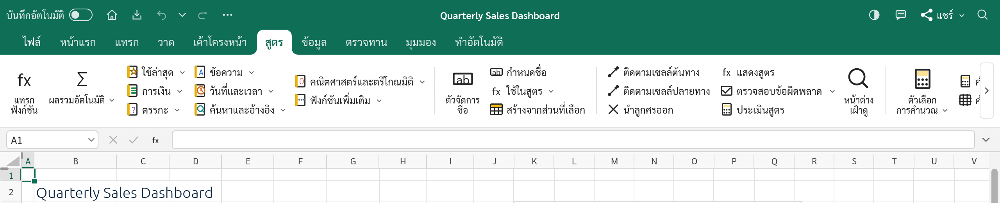

- **กล่องโต้ตอบเป็นภาษาไทย** หน้าต่างถามบันทึกการเปลี่ยนแปลงเป็นภาษาไทยทั้งหมดในทั้งสามโปรแกรม และกล่องโต้ตอบที่ใช้บ่อยของเขียนครับ เช่น ฟอนต์ ย่อหน้า ตั้งค่าหน้ากระดาษ ค้นหาและแทนที่ สัญลักษณ์ และ ไฟล์ › ตัวเลือก เป็นภาษาไทยแล้ว / **Dialogs in Thai.** The Save Changes prompt is all Thai in all three apps, and KhianKrub's most-used dialogs, such as Font, Paragraph, Page Setup, Find and Replace, Symbol and File › Options, are now in Thai.

- **เขียนครับ: อัปเดตจาก WordCraft** คัดลอกและตัดทั้งตาราง แถว หรือเซลล์ได้ (คัดลอกสองแถวไปวางก็ได้ตารางสองแถว) ข้อความในรูปร่างหมุนตามรูปร่าง บันทึกเป็นแม่แบบ `.dotx` เลขลำดับ a. b. c. เลขหัวข้อ จุดนำแท็บ และเส้นขอบย่อหน้าเหมือน Word มากขึ้น และเปิดไฟล์ `.doc` `.docx` `.rtf` ได้ถูกต้องขึ้น / **KhianKrub: WordCraft update.** Copy and cut whole tables, rows or cells (two copied rows paste as a two-row table), text that turns with its shape, `.dotx` templates, a. b. c. numbering, list numbers, tab leaders and paragraph borders closer to Word, and better `.doc`, `.docx` and `.rtf` files.

  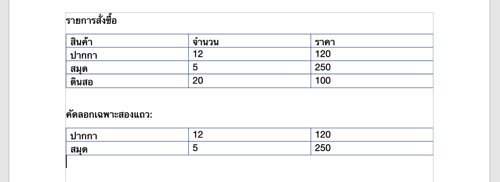

- **Google Drive ในพูดครับและคิดครับ** เชื่อมต่อ Google Drive ในคลิกเดียวแบบเดียวกับเขียนครับ เปิดงานนำเสนอ `.pptx` หรือตารางคำนวณ `.xlsx` จาก Drive แก้ไขแล้วกดบันทึก (Ctrl+S) ไฟล์เดิมใน Drive จะถูกบันทึกทับ หรือบันทึกเป็นสำเนาใหม่ก็ได้ หน้าเปิดและหน้าบันทึกมีสองที่ให้เลือก คือเครื่องนี้และ Google Drive โปรแกรมเข้าถึงเฉพาะไฟล์ที่คุณเลือกหรือที่โปรแกรมสร้างเท่านั้น / **Google Drive in PhutKrub and KhitKrub.** Connect Google Drive in one click, as in KhianKrub; open a `.pptx` presentation or an `.xlsx` workbook from Drive, edit it, and Save (Ctrl+S) puts it back over the same file, or save a new copy. The Open and Save pages offer two places, this device and Google Drive. The apps see only the files you pick or they create.

**2 พฤศจิกายน 2569 / 2 November 2026**

- **หน้า KrubOffice ใช้ไอคอนแบบกระจกชุดใหม่** ตัว ข ค พ สีทองแบบเดียวกับโลโก้ของแต่ละโปรแกรม / **The KrubOffice page has the new glass icons**: the same gold ข, ค and พ as each app's logo.
- **กรอบสีของแต่ละโปรแกรม** เมื่อชี้หรือเลือกไอคอน กรอบรอบไอคอนเป็นสีของโปรแกรมนั้น สีกรมท่าสำหรับเขียนครับ สีเขียวอมน้ำเงินสำหรับคิดครับ และสีส้มอิฐสำหรับพูดครับ / **Each app's own ring.** Pointing at or selecting an icon draws a ring in that app's colour: navy for KhianKrub, teal for KhitKrub and coral for PhutKrub.
- **ภาพเคลื่อนไหวขณะรอเปิดโปรแกรม** พูดครับและคิดครับมีแผ่นสีทองกับแผ่นสีของโปรแกรมลอยเข้ามาซ้อนหลังโลโก้ แบบเดียวกับเขียนครับ / **A loading animation** in PhutKrub and KhitKrub: a gold sheet and a sheet in the app's colour fly in behind the logo, as in KhianKrub.

**1 พฤศจิกายน 2569 (ไอคอนชุดใหม่) / 1 November 2026 (new icons)**

- **ไอคอนชุดใหม่ใช้ร่วมกันทั้งสามโปรแกรม** ไอคอนบนริบบิ้นวาดใหม่ทั้งชุด เส้นสีเข้มอ่านง่าย แต้มสีทองเฉพาะส่วนสำคัญ ปุ่มเดียวกันจึงหน้าตาเหมือนกันทั้งเขียนครับ พูดครับ และคิดครับ / **One new icon set for all three apps.** Every ribbon icon is redrawn with dark, easy-to-read lines and a touch of gold where it matters, so the same button looks the same in KhianKrub, PhutKrub and KhitKrub.
- **ริบบิ้นแบบเดียวกัน** พูดครับและคิดครับใช้ขนาดริบบิ้นของเขียนครับ ไอคอนใหญ่ขึ้น ปุ่มเรียงกึ่งกลาง / **One ribbon layout.** PhutKrub and KhitKrub now use KhianKrub's ribbon: larger icons, centred buttons.
- **พูดครับจัดข้อความแบบกระจายไทยได้** ปุ่มตัว ท ถัดจากปุ่มจัดชิดขอบทั้งสองด้าน กระจายระยะระหว่างตัวอักษรไทยให้เต็มบรรทัด บันทึกลงไฟล์ `.pptx` ได้ เขียนครับมีความสามารถนี้อยู่แล้วและได้ไอคอน ท เหมือนกัน / **Thai Distribution in PhutKrub.** A ท button next to Justify spreads the space between Thai letters to fill each line, and is saved in `.pptx`. KhianKrub already had it and gets the same ท icon.
- **โลโก้แบบกระจก** ตัว ข ค พ สีทองมีประกายแบบกระจก ที่หน้ารอเปิดโปรแกรมและหน้าเริ่มต้นของแต่ละโปรแกรม / **Glass logos.** A gold ข, ค and พ with a glass shine on each app's loading and start screens.

  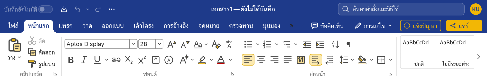
  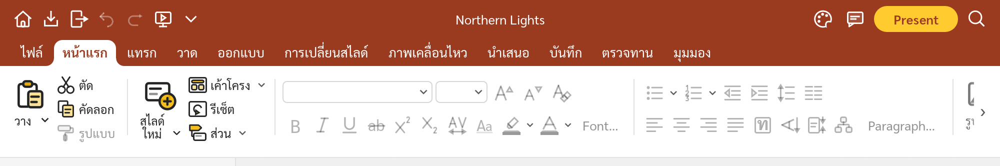
  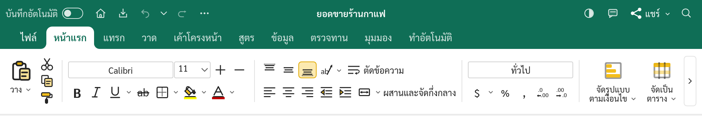

<table>
<tr>
<td width="33%" valign="top">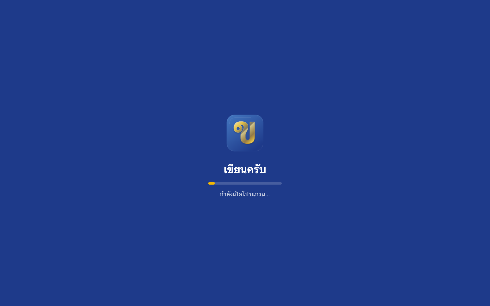
<b>เขียนครับ</b>
</td>
<td width="33%" valign="top">
<b>พูดครับ</b>
</td>
<td width="33%" valign="top">
<b>คิดครับ</b>
</td>
</tr>
</table>

**1 พฤศจิกายน 2569 / 1 November 2026**

- **คิดครับ (KhitKrub) เปิดให้ใช้แล้ว** ที่ [khitkrub.app](https://khitkrub.app/) เมนูไทย ฟอนต์ไทย แถบด้านบนสีเขียวอมน้ำเงิน ไฮไลต์สีทอง หน้าเริ่มต้นพร้อมฉบับร่างในเบราว์เซอร์ / **KhitKrub is available** at [khitkrub.app](https://khitkrub.app/): Thai menus and fonts, a teal top band with gold highlights, and a start screen with browser drafts.
- **หน้า KrubOffice** มีไอคอนคิดครับพร้อมใช้ และปุ่มสลับแอปในทุกโปรแกรมพาไปยังคิดครับได้ / **The KrubOffice page** now has KhitKrub's icon ready to open, and every app's switcher leads to it.

**31 ตุลาคม 2569 / 31 October 2026**

- **พูดครับ (PhutKrub) เปิดให้ใช้แล้ว** ที่ [phutkrub.app](https://phutkrub.app/) เมนูไทย ฟอนต์ไทย แถบด้านบนสีส้มอิฐ ไฮไลต์สีทอง หน้าเริ่มต้นพร้อมฉบับร่างในเบราว์เซอร์ / **PhutKrub is available** at [phutkrub.app](https://phutkrub.app/): Thai menus and fonts, a coral top band with gold highlights, and a start screen with browser drafts.
- **หน้า KrubOffice** มีไอคอนพูดครับพร้อมใช้ และปุ่มสลับแอปในพูดครับพาไปยังเขียนครับได้ / **The KrubOffice page** now has PhutKrub's icon ready to open, and PhutKrub's app switcher leads to KhianKrub.

ประวัติรุ่นของแต่ละโปรแกรมอยู่ที่หน้า Releases ของ [khiankrub-web](https://github.com/chanonss/khiankrub-web/releases), [phutkrub-web](https://github.com/chanonss/phutkrub-web/releases) และ [khitkrub-web](https://github.com/chanonss/khitkrub-web/releases) / Each app's release history is on its Releases page.

## เริ่มใช้งาน / Getting started

1. เปิด / Visit **[kruboffice.app](https://kruboffice.app/)** บนคอมพิวเตอร์หรือ iPad / on a computer or iPad.
2. เลือกโปรแกรม แล้วเลือกแม่แบบหรือฉบับร่างที่หน้าเริ่มต้น หรือกด **เปิดไฟล์** / Pick an app, then a template or a draft on its start screen, or press **Open file**.
3. บันทึกงานผ่าน **ไฟล์ → บันทึก** แล้วเก็บไฟล์ไว้ในเครื่อง / Save through **File → Save** and keep the file on your device.

## ความเป็นส่วนตัว / Privacy

งานของคุณถูกประมวลผลในเบราว์เซอร์ ไม่ถูกส่งขึ้นเซิร์ฟเวอร์ ฉบับร่างเก็บไว้ในเบราว์เซอร์ของอุปกรณ์เครื่องนั้นเท่านั้น หากใช้เครื่องร่วมกับผู้อื่น ควรทิ้งฉบับร่างเมื่อเสร็จงาน การเชื่อมต่อ Google Drive ของทั้งสามโปรแกรมเป็นทางเลือกและทำเมื่อคุณสั่งเท่านั้น โปรแกรมเข้าถึงเฉพาะไฟล์ที่คุณเลือกหรือที่โปรแกรมสร้าง เพื่อให้เชื่อมต่อค้างไว้ บริการที่ drive.khiankrub.app, drive.phutkrub.app และ drive.khitkrub.app (บริการเดียวกัน) เก็บโทเค็นของ Google แบบเข้ารหัส และยกเลิกการเชื่อมต่อได้ทุกเมื่อ รายละเอียดอยู่ที่ [นโยบายความเป็นส่วนตัว](https://khiankrub.app/privacy.html) / Your work is processed in the browser and not sent to a server. Drafts stay in that device's browser; on a shared device, discard them when you finish. Google Drive is optional in all three apps and only used when you ask for it; the apps see only the files you pick or they create. To keep you connected, the service at drive.khiankrub.app, drive.phutkrub.app and drive.khitkrub.app (one service) stores Google tokens encrypted, and you can disconnect at any time. See the [privacy policy](https://khiankrub.app/privacy.html).

พบปัญหาหรือมีข้อเสนอแนะ กดปุ่ม **แจ้งปัญหา** ในเขียนครับ / Found a problem or have a suggestion? Press **Report a problem** (แจ้งปัญหา) in KhianKrub.

## เครดิตและสัญญาอนุญาต / Credits and licences

- เขียนครับและพูดครับพัฒนาต่อยอดจาก [WordCraft](https://github.com/storytold/wordcraft) และ [DeckCraft](https://github.com/storytold/deckcraft) โดยทีม ArtCraft (MIT หรือ Apache-2.0) ปรับปรุงสำหรับผู้ใช้ภาษาไทยโดย Chanon Sarasuk / KhianKrub and PhutKrub are based on WordCraft and DeckCraft by the ArtCraft team (MIT or Apache-2.0), adapted for Thai users by Chanon Sarasuk.
- ฟอนต์ Sarabun อยู่ภายใต้ SIL Open Font License 1.1 และ TH Sarabun New อยู่ภายใต้ GPL พร้อมข้อยกเว้นสำหรับฟอนต์ / Sarabun is under the SIL Open Font License 1.1; TH Sarabun New is under the GPL with the font exception. Other components keep their own licences: see [`ATTRIBUTION.md`](ATTRIBUTION.md) and [`NOTICE`](NOTICE).
- ภาพหน้าจอถ่ายจากโปรแกรมจริง ข้อความและงานตัวอย่างเป็นงานต้นฉบับ ไม่มีหน้าตาหรือสื่อของ Microsoft / The screenshots are taken from the running apps; the text and sample documents are original, with no Microsoft interface or assets.
- **ซอร์สโค้ดของเขียนครับและพูดครับเป็นส่วนตัวในขณะนี้** คลังนี้มีเฉพาะหน้ารวมที่คอมไพล์แล้ว / **The source code of KhianKrub and PhutKrub is currently private.** This repository holds the compiled front page only.
